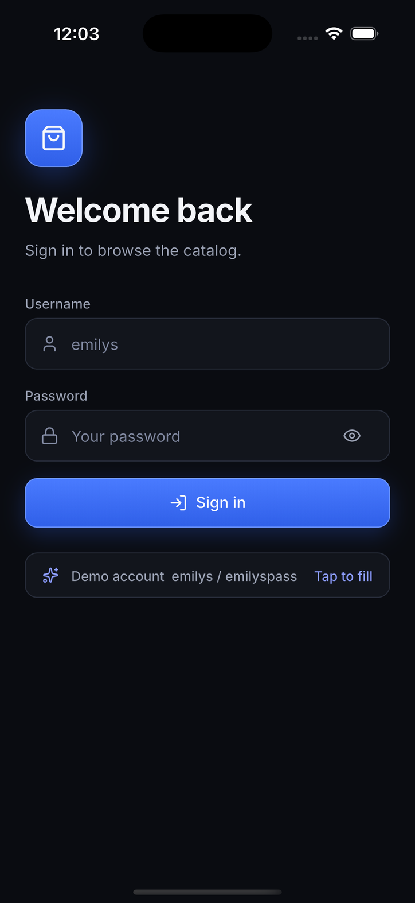
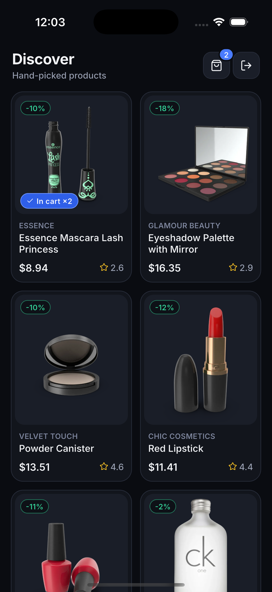
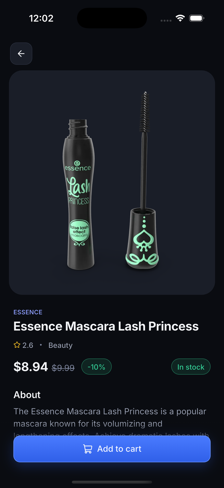
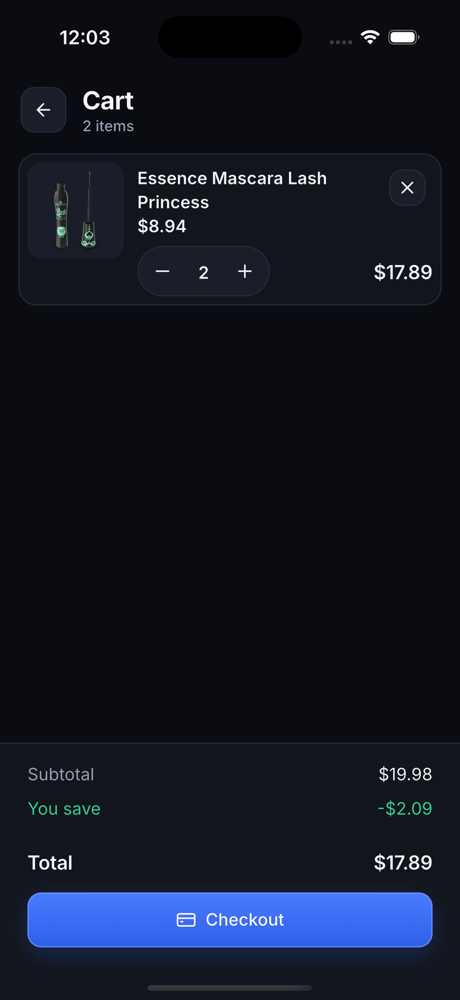
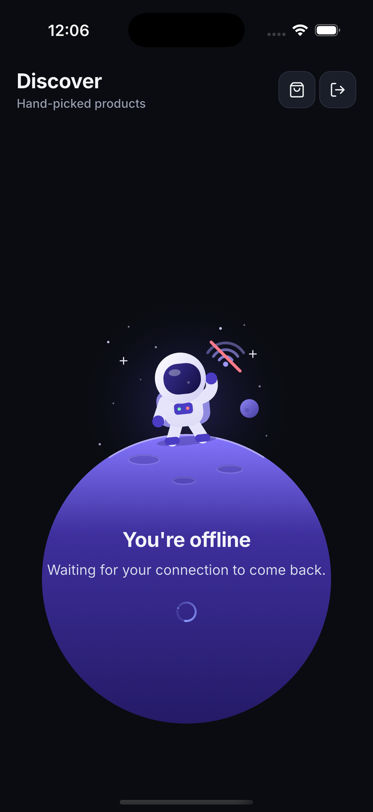

# Shop app

A Flutter client for https://dummyjson.com with login, a paged product list, a product detail page and a local cart. It uses the real API, keeps the session in secure storage, refreshes expired tokens and waits out lost connectivity.

```sh
flutter pub get
cd apps/shop_app && flutter run
```

<p>
  
  
  
  
  
</p>

Log in with `emilys` / `emilyspass`. Debug builds log one `[net]` line per request, retry and refresh. Long-press the title on the login or list screen to open a debug panel that forces offline, 500s and 401s.

## Decisions

- **Monorepo.** `apps/shop_app` is the app. `packages/network` (Dio, interceptors, token store, connectivity) knows nothing about the app. `packages/dummyjson_api` is generated. `packages/ui_kit` holds the design tokens and widgets.
- **Generated API, thin repositories.** The client comes from dummyjson's OpenAPI spec (`tools/generate_api.sh`). Only `features/*/data/api_*` and `app/overrides.dart` import it. Screens and controllers see repository interfaces and domain models.
- **Riverpod plus context_watch.** `flutter_riverpod` injects dependencies and owns controller lifetimes. Controllers are `ValueNotifier`s holding sealed states, and widgets read them with `context_watch`. Nothing is observed by both.
- **Tokens in `flutter_secure_storage`.** Keychain on iOS, encrypted storage on Android. At launch the stored session is validated with `GET /auth/me`.
- **Refresh on 401.** One refresh is shared by concurrent requests, then the failed request is replayed once. If the refresh is rejected, the tokens are cleared and the app returns to login. A refresh that fails because of the network does not log the user out.
- **`/auth/products`, not `/products`.** The public route never returns 401, which would make the refresh flow dead code. The authenticated route does.
- **Offline and retries live in the Dio chain,** so any screen gets them. While offline, requests fail fast and the screen shows the offline view with a spinner, then resumes by itself when connectivity returns. Connectivity combines `connectivity_plus` with a real reachability probe.
- **No Material widgets,** so the UI is custom. A plain `Navigator` is enough for four screens with no deep links.
- **Cart is local.** dummyjson carts are fake, so a server cart would add nothing.

## Interceptor order

```
connectivity -> auth -> log -> debug -> retry -> refresh
```

Retry handles connection errors, timeouts and 5xx for idempotent requests, with backoff and jitter. It ignores 401. Refresh handles only 401. A connection retry therefore never triggers a refresh, and a refresh replay happens at most once. The refresh call uses its own Dio, so it cannot recurse.

## Extras

- **Accessibility.** Buttons, fields, the quantity stepper and icon-only buttons carry labels and states. Each product card reads as one item, such as "title, brand, price, rating, in cart". Loading, error, empty and offline states are announced. Tap targets are at least 44 points. Layouts hold up at large text sizes, secondary text meets 4.5:1 contrast, and reduced motion skips the Hero, slide-ins and shimmer.
- **Cart.** Add to cart from the detail page, an "In cart" chip on list cards, and a cart screen with a quantity stepper and a checkout confirmation. It is local only.

## Trade-offs and next steps

- dummyjson answers 500, not 401, for a tampered JWT. The app treats that as a server error.
- The access token is refreshed on 401, not ahead of expiry. Decoding `exp` would save one failed request.
- The cart is not persisted.